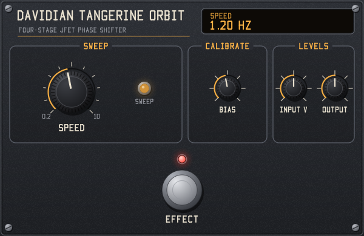

# Davidian Tangerine Orbit

A Davidian circuit model of a classic orange one-knob phaser schematic (four JFET all-pass stages with the 22k feedback resistor), as an LV2, VST3 and Audio Unit plugin with the same panel in every format. Mono, no latency.

Free software under the GNU GPL, version 3 or later: see [LICENSE](LICENSE), and [NOTICE.md](NOTICE.md) for third-party licences, sources and acknowledgements. **Made with generative AI** (Claude Code): see [AI_USAGE.md](AI_USAGE.md). The build copies all three files into every bundle.

## Formats

| Format | Windows | macOS | Linux |
|---|---|---|---|
| LV2 | yes | yes | yes |
| VST3 | yes | | |
| Audio Unit (AUv2) | | yes | |

## Install

Copy the bundle for your format into its folder, with the host closed, then start the host:

| Format | Bundle | Folder |
|---|---|---|
| VST3 (Windows) | `tangerine_orbit.vst3` | `C:\Program Files\Common Files\VST3` |
| Audio Unit (macOS) | `tangerine_orbit.component` | `~/Library/Audio/Plug-Ins/Components` |
| LV2 (Windows) | `tangerine_orbit.lv2` | `%APPDATA%\LV2` or `%COMMONPROGRAMFILES%\LV2`. Ardour 9 on Windows may only see it in `C:\Program Files\Ardour9\lib\ardour9\LV2` |
| LV2 (macOS) | `tangerine_orbit.lv2` | `~/Library/Audio/Plug-Ins/LV2` |
| LV2 (Linux) | `tangerine_orbit.lv2` | `~/.lv2` or `/usr/local/lib/lv2` |

In the host it is listed as **Davidian Tangerine Orbit** (VST3, LV2) or under **Davidian** as **Tangerine Orbit** (Audio Unit). Replace any older copy instead of keeping two. The LV2 URI is `urn:davidian:tangerine-orbit`.

The macOS build isn't notarized, so macOS may block it after download. Run these once in Terminal after copying:

```bash
xattr -dr com.apple.quarantine ~/Library/Audio/Plug-Ins/Components/tangerine_orbit.component
```

```bash
xattr -dr com.apple.quarantine ~/Library/Audio/Plug-Ins/LV2/tangerine_orbit.lv2
```

Logic Pro and GarageBand only show an Audio Unit once macOS has registered it. If it doesn't appear, log out and back in, or restart the Mac.

## GUI



Every format has the same native panel, in the Davidian house style, using the shared `style.h`, `font.h` and `canvas.h` unchanged. The panel is called **Tangerine Orbit**, an original name with none of the original pedal's branding. It has no dependencies: it draws with its own software renderer and shows the result in a Win32 window, a Cocoa view on macOS, or an X11 window on Linux (LV2 only).

- Drag a knob up or down to turn it. Hold Shift for fine control. Double-click resets it, and the mouse wheel works too.
- Click the footswitch to switch the effect on or off. Its red LED shows the state.
- The amber SWEEP lamp brightens and dims with the oscillator. It goes dark while the effect is off.
- The readout shows the name and value of the last control you touched.
- In VST3 and Audio Unit hosts, each drag or click is one automation gesture.

## Controls

| Control | Range | Default | Notes |
|---|---|---|---|
| Speed | 0.2–10 Hz | 0.5 Hz | Sets the 500k pot's resistance. In Hz rather than pot position, because the schematic's linear pot crowds the fast settings into the last few percent of its travel |
| Bias Trim | 0–1 | 0.46 | The 250k trim. Moves the whole sweep up or down |
| Volts at 0 dBFS | 0.1–10 | 1.0 | Voltage a full-scale digital signal represents. Higher drives the JFETs and op amps harder and comes out quieter; lower does the reverse |
| Output | -24 to +12 dB | -6 dB | Not on the pedal. The circuit peaks about 7 dB above its input, so -6 dB roughly levels it with bypass. It comes after the circuit and doesn't change the tone |
| Enabled | on/off | on | The host's bypass: 20 ms crossfade. The sweep keeps running while bypassed. In VST3 it is the host's bypass switch; in an Audio Unit host, its bypass turns this off |
| Effect On | on/off | on | The panel's footswitch, with the same crossfade. The effect is in only when this and Enabled are both on |
| Sweep Position | 0–1 | output | Where the oscillator is, for the panel's lamp. An LV2 output port; the VST3 and AU panels read it from the plugin directly |

The output is inverted relative to bypass, because the schematic's mixing stage is inverting. On a stereo track the VST3 and Audio Unit versions mix the two inputs to mono and send the output to both sides; LV2 hosts run one copy per channel.

## Build

The code is plain C11 (Objective-C for the macOS GUI and Audio Unit) with no dependencies beyond the platform's own libraries: Win32 on Windows, Cocoa and AudioToolbox on macOS, Xlib on Linux and BSD. No LV2, VST3 or AU SDK is needed: the VST3 version uses Steinberg's one-file C API header, included in `src/vst3/`.

### Windows (Visual Studio)

Needs Visual Studio 2019 or later with the C++ workload. `build.bat` finds it on its own, and builds `build\tangerine_orbit.lv2` and `build\tangerine_orbit.vst3`.

```bash
build.bat
```

### macOS, Linux, BSD, MinGW

Needs a C compiler and `make`. On Linux, also the X11 headers (`libx11-dev` on Debian/Ubuntu). On macOS, the Xcode command-line tools; the build is universal (Apple silicon and Intel) and also makes the Audio Unit, `build/tangerine_orbit.component`.

```bash
make
```

`make install` copies the LV2 bundle to your user LV2 folder, and on macOS the Audio Unit to `~/Library/Audio/Plug-Ins/Components`.

## Tests

Windows:

```bash
build.bat test
```

macOS, Linux:

```bash
make test
```

- `test_dsp` compares the circuit code to the schematic's transfer function, checks sweep rates and range, and tests the built plugin: bypass, footswitch, sweep output, silence, bad input, every sample rate and CPU cost.
- `ui_render` draws the panel to a BMP file.
- `ui_check` (Windows) and `ui_check_mac` (macOS) load the LV2 GUI the way a host does, drive it with mouse events and check the values it sends back.
- `vst3_check` (Windows) loads the VST3 the way a host does and checks the factory, buses, parameters, audio, latency, both bypasses and saved state, then opens the editor and drives it with the mouse, checking each edit reaches the host inside a begin/end gesture.
- `au_check_mac` (macOS) opens the installed Audio Unit and checks the same things, including its Cocoa view. Run `make install` first.
- `load_check` (Linux, macOS) loads the LV2 plugin and GUI with `dlopen` and runs them.
- `lilv_check` (Windows) validates the LV2 bundle with the LV2 parser from an Ardour 9 install, without installing anything: `build-test\lilv_check.exe build`. On Linux, CI checks it with `lv2info`.

GitHub Actions runs these on Windows, macOS, Linux x64 and Linux arm64 for every push (see `.github/workflows/build.yml`), plus Steinberg's VST3 validator on the Windows build and Apple's `auval -strict` on the Audio Unit. Pushing a `v*` tag publishes a release with a zip for each platform.

## Code layout

| File | Contents |
|---|---|
| `src/input_buffer.h` | Stage 1: input coupling and IC1a follower |
| `src/allpass.h` | Stage 2: four all-pass stages, JFETs, feedback |
| `src/mix_amp.h` | Stage 3: 2N4125 mixing stage and output coupling |
| `src/lfo.h` | Stage 4: IC3b oscillator, gate bus, bias trim |
| `src/phaser.h` | Audio path in schematic order |
| `src/engine.h` | The engine shared by every format: controls, smoothing, bypass, sweep output |
| `src/plugin.c` | LV2 plugin entry points |
| `src/vst3/vst3.c` | VST3 plugin, with its editor |
| `src/au/au.m` | Audio Unit, with its Cocoa view |
| `src/ports.h` | Port numbers, also the VST3 and AU parameter IDs |
| `src/ui/panel.h` | Panel layout, drawing and mouse handling |
| `src/ui/window.h` | The window layer under the panel (Win32, Cocoa, X11), shared by every GUI |
| `src/ui/ui_lv2.c` | LV2 GUI entry points |
| `src/ui/style.h`, `font.h`, `canvas.h` | Davidian GUI house style, shared unchanged across Davidian plugins |
| `src/lv2_abi.h` | The LV2 C interface, so no SDK is needed |
| `src/vst3/vst3_c_api.h`, `LICENSE.txt` | Steinberg's VST3 C API header and its licence |
| `bundle/` | LV2 metadata (the manifest is a template the build fills in per platform) and the Audio Unit's `Info.plist` |
| `test/` | The tests above; `ui_script.h` is the GUI script they share |
| `LICENSE`, `NOTICE.md`, `AI_USAGE.md` | GPL-3.0 text, third-party licences, sources and acknowledgements, AI usage statement |

## Values not from the schematic

These are estimates to tune by ear or against a real pedal:

- JFET Vp -2.0 V and Idss 2.5 mA, mid-range for the 2N5952 and the biggest influence on the sweep range (`src/allpass.h`)
- Zener 4.3 V, picked from the 3.6–4.7 V range on the parts list (`src/circuit.h`)
- TL072 output swing of 1.5–7.5 V (`src/circuit.h`)
- 2N4125 saturation current, beta and collector limit (`src/mix_amp.h`)
- Bias Trim default, set so the JFETs stay conducting across the sweep (`src/engine.h`, `bundle/tangerine_orbit.ttl`)

## Simplifications

- Op amp clipping is applied at the input buffer and at stage 4's output, not inside each all-pass stage. This only matters at very high levels.
- Op amps are otherwise ideal, so their bandwidth and slew limits aren't modelled.

## Licence

Copyright (C) 2026 Davidian. Released under the GNU General Public License, version 3 or (at your option) any later version. Every source file carries an `SPDX-License-Identifier` line. `src/lv2_abi.h` is under the ISC licence and `src/vst3/vst3_c_api.h` under Steinberg's 3-clause BSD licence, both GPL-compatible. [NOTICE.md](NOTICE.md) lists every licence and source and credits the projects this builds on. [AI_USAGE.md](AI_USAGE.md) says how AI was used.
